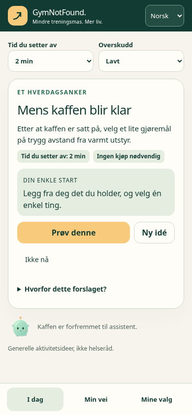

# GymNotFound

**En morsom, overraskende intelligent aktivitetskamerat som får folk bort fra skjermen og ut i livet.** Ikke en vanlig treningsapp; ikke et sosialt nettverk.

Offentlig navn: **GymNotFound**. Teknisk slug: **gymnotfound**. NIM er en valgfri maskot. Engelsk og norsk fra første versjon.

## Gjeldende byggemål fra 14.10.2026

**GymNotFound 0.1.0-beta.1 – første installérbare WordPress-beta.**

Den eldre «IKKE TRENING 5.0»-spesifikasjonen var for omfattende som første leveranse. Eier har nå besluttet en smalere MVP med én hovedskjerm, relevant aktivitetsforslag, ekte vær- og stedsintegrasjoner der datakilder er tilgjengelige, by/land-tilpasning og enkel privat historikk. AI, Ticketmaster, større fortellinger og venne-/kontosystem er utsatt.

**Start hos [MVP produktkrav og datakilder](docs/10_MVP_0_1_AKTIVITETSKAMERAT.md) og [MVP akseptanse- og testkrav](docs/11_MVP_0_1_AKSEPTANSETEST.md).**

[AGENTS.md](AGENTS.md) bestemmer dokumentenes prioritet. Eldre dokumenter i docs/00–09 er beholdt som konseptgrunnlag, senere backlog og bindende sikkerhetsprinsipper der de ikke står i konflikt med MVP-scope.

## Hva første versjon gjør

- Gjest åpner appen uten konto og får straks ett relevant og lavterskel aktivitetsforslag.
- Tid, overskudd, svarhistorikk og valgfri urban/landlig kontekst påvirker en **regelbasert** motor. NIM tilfører tørr humor uten å skape press.
- Minimum 36 redigerte aktivitetsmaler på engelsk og norsk. Fungerer uten GPS, API-nøkler eller nettbaserte stedstreff.
- **MET Norway** leverer gratis værdata når lokasjon er kjent (server-side og cached).
- Valgfri gratis **Geoapify Places**-nøkkel gir faktiske steder, kategorier og stedstype; ingen fantasisteder eller krav om Google Places. Google Maps URLs brukes bare til å åpne veibeskrivelser.
- «Gjort» er egenrapportert, «Prøv» er ikke fullført. Lokal historikk, eksport/sletting og enkel administrasjon.
- Én selvstendig WordPress-plugin ZIP med ferdigbygde assets. Ingen obligatorisk WP-theme, AI-API, betalingsabonnement eller eksterne trackingtjenester.

## Installérbar beta

[Last ned ZIP](dist/gymnotfound-0.1.0-beta.1.zip) og følg [installasjonsguiden](docs/INSTALLASJON.md). På webhotellet trengs bare WordPress 6.7+ og PHP 8.2+; Node og Composer er ikke nødvendig. Aktivering oppretter 36 redigerbare maler, mens appsiden opprettes som utkast først ved adminens uttrykkelige handling.

Implementasjonen er testet i lokal WordPress/MariaDB, med faktisk ZIP-opplasting i WP-admin, Chromium, provider-fixtures og en ekte MET-forespørsel. [Testmatrisen](docs/TESTRAPPORT.md) inneholder bevis, miljø og begrensninger. Firefox og direkte Geoapify-livetest er **NOT RUN**, med begrunnelse. [Personvern og datakilder](docs/PERSONVERN.md) beskriver lokal historikk, frivillig område og eksterne lenker.



4.1-prototypen i reference/ er fortsatt historisk designreferanse. Den inngår ikke i pluginen.

## Lokal utvikling

```sh
npm ci --ignore-scripts
bash scripts/cloud-start.sh
npm run check
npm run test:unit
docker compose run --rm cli wp eval-file gnf-tests/integration.php
docker compose run --rm cli wp eval-file gnf-tests/concurrency.php
npm test
npm run build
```

Kjør backend-testene ferdig før nettlesertestene, siden de bruker samme lokale database. Standardnettleseren er `/usr/bin/chromium`. Kjerneflyten krever ingen API-nøkkel. ZIP-teststakken i compose.zip.yaml har egne volum og kun en lokal tillitsfil for skymiljøets CA, uten montert plugin-kildekode. Se installasjonsguidens utviklingsdel for en ren ZIP-test. Ingen tunge Actions-jobber på hvert push.

Ingen merge eller produksjonsinstallasjon uten uttrykkelig eiergodkjenning.
