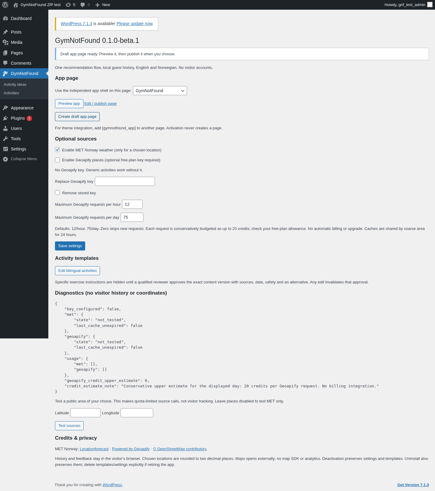

# Installere GymNotFound 0.1.0-beta.1

Pakken er [dist/gymnotfound-0.1.0-beta.1.zip](../dist/gymnotfound-0.1.0-beta.1.zip). Den inneholder PHP, JavaScript, CSS, SVG og 36 tospråklige aktivitetsmaler. Webhotellet trenger WordPress 6.7+, PHP 8.2+ og vanlig MySQL/MariaDB. Ingen terminal, Node, npm eller Composer trengs på One.com eller et annet WordPress-webhotell.

Installer på et lukket testnettsted først, etter eierens separate godkjenning. Lokal testinstallasjon og en åpen pull request gir ikke godkjenning til produksjonsinstallasjon eller sammenslåing.

## I WordPress-admin

1. Ta vanlig sikkerhetskopi av testnettstedet. Åpne **Utvidelser → Legg til ny → Last opp utvidelse**.
2. Velg ZIP-filen, trykk **Installer nå**, deretter **Aktiver**. Navnet er **GymNotFound**, slug og text domain er `gymnotfound`.
3. Åpne **GymNotFound** i administrasjonsmenyen. Aktivering lager aktivitetsmaler, og oppretter ingen side, gjestekonto eller ekstern forespørsel.
4. Trykk **Create draft app page**. Et utkast opprettes og velges som appside. Bruk **Preview app** og kontroller norsk/engelsk. Publiser siden når eieren har godkjent dette på testnettstedet. Gjentatt oppretting bruker den samme eksisterende siden.
5. Alternativt velger du en eksisterende side i oppsettet. Valgt side får et selvstendig appskall, med WordPress sine vanlige head/footer-hooks, uten krav om eget tema. Vil du bruke nettstedets tema rundt appen, legg kortkoden `[gymnotfound_app]` på en annen side.
6. Åpne **Activity ideas / Edit bilingual activities** for å redigere maler. WordPress-tittel og editor er engelsk tittel/beskrivelse; egne felter dekker norsk, enkel start, NIM-replikk, tid, energi, miljø, stedskategori og kostnadsvalg.



## Valgfrie kilder

Generiske ideer virker uten nøkkel, GPS og værsvar. Førstegangsbesøk gir aldri en automatisk posisjonsdialog.

**Vær:** MET Norway er aktivert som standard, men kalles først når besøkende uttrykkelig velger og lagrer et område. Admin kan slå vær av. Nettstedet må kunne nå `https://api.met.no`. Pluginen bruker prosjektidentifiserende User-Agent, TLS, delt cache og maksimum 60 nye MET-kall/time og 300/døgn. Et ukjent eller gammelt varsel presenteres ikke som aktuelt vær.

**Steder:** Geoapify er avslått som standard. Eieren kan selv opprette en legitim gratisplan-nøkkel, angi den i passordfeltet og aktivere steder. Verdien vises aldri igjen, er kryptert server-side med WordPress-salt, og havner ikke i appens JavaScript eller REST-svar. Saltrotasjon eller flytting med nye salts kan gjøre nøkkelen uleselig; legg den da inn på nytt.

Steds- og manuelt bysøk bruker samme kvote: standard 12 forespørsler/time og 75/døgn (UTC), maksimum 30/time og 100/døgn. Null stopper nye kall; allerede gyldige cachetreff kan fortsatt brukes. Hvert kall budsjetteres konservativt som opptil 20 kreditter, altså opptil 1500/døgn med standardtak. Kontroller egen gratisplan og andre apper på samme konto; pluginen styrer bare sine egne kall og aktiverer aldri betaling eller oppgradering. Stedssvar deles per grovt område/radius i 24 timer, med opptil 20 leverandørtreff per forespørsel.

Nettstedet må kunne nå `https://api.geoapify.com` dersom steder er aktivert. Det er ingen Nominatim-autocomplete, Google Places, kartfliser eller Google Maps SDK. Maps-lenker åpner eksternt og inneholder bare det offentlige besøksstedet, uten brukerens startposisjon.

**Test sources** i admin er en uttrykkelig test av et valgt offentlig område. Den bruker de samme kvotene og viser status uten besøkendes historikk, rå posisjon eller nøkkel. Diagnostikken viser egne kall, kredittestimat og siste cacheutløp. Kreditering vises ved data som faktisk brukes.

## Innhold og gjestedata

De inkluderte malene er generelle aktivitetsvalg, uten foreskrevet treningsprogram. Merk nye konkrete bevegelsesinstruksjoner; gjenkjente øvelsestermer utløser også godkjenningsporten. De blir skjult for besøkende uten revisor, gyldig dato, HTTPS-kilde, sikkerhet, alternativ og uttrykkelig godkjenning av den eksakte innholdsversjonen. Enhver endring ugyldiggjør den gamle godkjenningen. Ordgjenkjenning er konservativ og erstatter ikke adminens faglige innholdskontroll.

Gjester får ingen WordPress-konto. **Mine valg** inneholder språk, tid, overskudd, miljø, gratisvalg, NIM, valgfritt område, eksport og sletting. «Prøv denne» lagres som `accepted`; kun «Gjort» gir `completed_self_report`. Historikken er per nettleser/enhet og synkroniseres ikke. Nettleser som nekter lokal lagring får en tydelig melding og kan fortsatt bruke ideer.

Deaktivering og avinstallering beholder administrasjonens maler og innstillinger. Slett malene og `gnf_*`-innstillingene uttrykkelig når appen skal avvikles; nettstedets administrator kan gjøre dette som en separat vedlikeholdsoppgave. Nettleserdata slettes av gjesten gjennom Mine valg, også før pluginen eventuelt fjernes. Les [personvern](PERSONVERN.md).

## Verifisering før godkjent pilot

Prøv begge språk, tid/energi og åtte nye ideer. Kontroller at «Prøv» ikke øker historikken, at «Gjort» gjør det, og at eksport, avbryt/slett, NIM og fjern område virker. Test kildene med din egen hosting og eventuell nøkkel. Offline-støtten gjelder en allerede åpnet app; en første sideinnlasting eller ny innlasting uten nett trenger forbindelsen til WordPress. Ingen service worker eller PWA blir installert.

Lokal verifikasjon er utført med WordPress 6.8.3 og 7.1.3, PHP 8.3.28 i webserveren, PHP 8.3.35 i CLI og MariaDB 11.4. Testet nettleser er Chromium 154. Firefox-oppstart ble blokkert av miljøets skrivebeskyttede prosessnavnerom/grafikkmiljø, og direkte Geoapify er ikke kjørt uten legitim nøkkel. Minimumskombinasjonen WP 6.7/PHP 8.2 er ikke separat kjørt. Full [testmatrise med bevis](TESTRAPPORT.md) følger leveransen.

## Utvikling og lokal ZIP-test

Denne delen er for repoets utviklingsmiljø, og kreves ikke på webhotellet. Docker-portene er bundet til loopback. Testpassord og testkontoer gjelder bare de isolerte lokale stakkene. Skymiljøets proxy og CA beholdes; tillitsfilen i `tests/mu-cloud-trust.php` følger aldri med i plugin-ZIP-en.

```sh
npm ci --ignore-scripts
bash scripts/cloud-start.sh
npm run check
npm run test:unit
docker compose run --rm cli wp eval-file gnf-tests/integration.php
docker compose run --rm cli wp eval-file gnf-tests/concurrency.php
docker compose run --rm cli wp eval-file gnf-tests/live-met.php
npm test
npm run build
```

Kjør WordPress-testene og nettlesertestene sekvensielt. Provider-fixtures finnes bare i tests/, utenfor pakken. Backend-suiten rydder midlertidige nøkler, innstillinger, cache og testkort. Nettlesertestene bruker egne isolerte nettleserprofiler. Finn aktuell side-ID med `docker compose run --rm cli wp option get gnf_page_id`, og bruk `GNF_APP_PATH='/?page_id=ID'`. Testens standard 40 passer den opprinnelige lokale stakken; andre installasjoner kan få andre ID-er.

For **en ny**, tom ZIP-teststakk:

```sh
docker compose -f compose.zip.yaml up -d wordpress
docker compose -f compose.zip.yaml run --rm cli wp core install \
  --url=http://localhost:8081 --title='GymNotFound ZIP test' \
  --admin_user=gnf_test_admin --admin_password=LocalTestOnly_2026 \
  --admin_email=local-test@example.invalid --skip-email
node tests/install-zip.cjs
```

Dette tester faktisk filopplasting, aktivering, utkast/forhåndsvisning, malredigering, innstillinger og deaktivering i WP-admin. Stakken monterer ingen plugin-kildekode. Om du gjenbruker den, behold data eller tilbakestill bare denne uttrykkelig lokale testdatabasen; installer-scriptet forventer en ren plugin-installasjon.

WordPress Plugin Check kan installeres fra WordPress.org i den lokale utviklingsstakken og kjøres med `docker compose run --rm cli wp plugin check gymnotfound`. PHP lint bruker containerens PHP. Firefox kan kjøres med `GNF_FIREFOX=1` når Playwright-browseren og operativsystemets nødvendige rettigheter er tilgjengelige. Ingen CI-jobb kjøres på hvert push.
